---

[**`ESTABLISH CONNECTION // LINKEDIN`**](https://www.linkedin.com/in/sillashead/)

───[ <strong><code>🔒 / ACCESS RESTRICTED</code></strong> ]───

<code>ACCESS GRANTED.</code> There is no secret. <small><i>The real Easter egg was the unreasonable amount of effort spent on a README.</i></small>

---

