<picture>
  <source media="(prefers-color-scheme: dark)" srcset="./assets/firmware-v002-dark.svg">
  <source media="(prefers-color-scheme: light)" srcset="./assets/firmware-v002-light.svg">
  
</picture>

<div align="center">

[ `01 / OPEN A CHANNEL` ](mailto:sillas.ap16@gmail.com) &nbsp;·&nbsp; [ `02 / EXTERNAL NETWORK` ](https://www.linkedin.com/in/sillashead/)

</div>

<details>
<summary><code>03 / ACCESS RESTRICTED TRANSMISSION</code></summary>

```text
ACCESS GRANTED.
There is no secret.

The real Easter egg was the unreasonable
amount of effort spent on a README.
```

</details>
